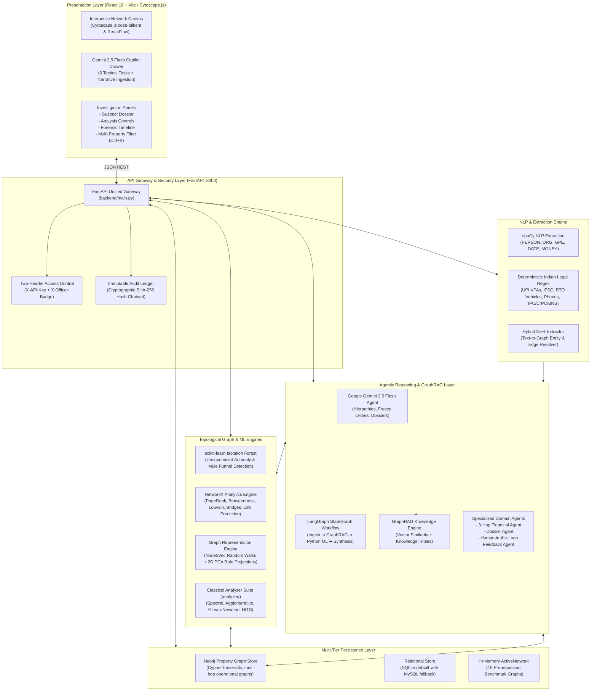
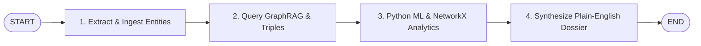

# CrimeNet — Criminal Network Analysis & Intelligence Platform

[](https://www.python.org/)
[](https://fastapi.tiangolo.com/)
[](https://react.dev/)
[](https://ai.google.dev/)
[](https://langchain-ai.github.io/langgraph/)
[](https://neo4j.com/)
[](https://spacy.io/)
[](https://github.com/microsoft/graphrag)
[](https://scikit-learn.org/)
[](https://networkx.org/)
[](LICENSE)

> **CrimeNet AI** is an interactive, explainable criminal intelligence and network analysis platform architected for law enforcement investigating officers (IOs), cyber crime cells, financial intelligence units (FIU-IND), and intelligence analysts.
>
> It translates unstructured and multimodal evidentiary records—such as First Information Reports (FIRs), Call Detail Records (CDRs), interrogation notes, bank statements, UPI transactions, and Automated Number Plate Recognition (ANPR) hits—into topological intelligence graphs backed by **Google Gemini 2.5 Flash**, **LangGraph**, **GraphRAG**, **Neo4j**, **spaCy**, **scikit-learn Isolation Forest**, and **NetworkX**.

---

## ⚡ Quick Start: Modern Command Center

```powershell
# 1. Start the FastAPI REST Gateway (:8000)
python -m pip install -r backend/requirements.txt
python -m uvicorn backend.main:app --host 127.0.0.1 --port 8000 --reload
```

In a second terminal:

```powershell
# 2. Launch the React 18 / Vite Command Center (:5173)
cd frontend
npm install
npm run dev -- --host 127.0.0.1 --port 5173
```

- **Interactive UI**: [http://127.0.0.1:5173](http://127.0.0.1:5173)
- **API Swagger Documentation**: [http://127.0.0.1:8000/docs](http://127.0.0.1:8000/docs)
- **Public Health Liveness**: [http://127.0.0.1:8000/health](http://127.0.0.1:8000/health)

*(For deploying as a single unified service on Render or Docker, see [`DEPLOYMENT.md`](./DEPLOYMENT.md).)*

---

## 🏛️ Multi-Tier Platform Architecture



---

## 🎯 Core Capabilities & Intelligence Engines

### 1. 🤖 Google Gemini 2.5 Flash Investigative Copilot
Housed directly inside the left navigation drawer (`backend/agentic/gemini_agent.py` & `frontend/src/components/GeminiLeftChatbot.jsx`), the agent pairs interactively with law enforcement investigators. It executes **6 Core Tactical Tasks**:
1. **🎯 Syndicate Hierarchy & Mastermind Pinpointing**: Computes PageRank and Betweenness to separate top kingpins, conduit brokers, and mule accounts.
2. **💸 3-Hop Money Trail & Mule Account Tracing**: Traverses multi-hop financial vectors (Victim UPI ➔ Regional Mule Funnels ➔ Shell Logistics ➔ Offshore Accounts).
3. **🌲 Isolation Forest Anomaly Detection**: Surfaces high-risk statistical outliers and suspicious volume imbalances.
4. **⚖️ Statutory Legal Order Drafting (Sec 102 CrPC / Sec 107 BNSS)**: Drafts formal judicial-grade debit freeze notices for bank nodal officers and Lookout Circulars (LOC).
5. **💥 Communication Bridges & Single Points of Failure**: Identifies articulation points (`nx.articulation_points`) and bridges (`nx.bridges`) whose neutralization fractures the network.
6. **📜 GraphRAG Evidence Citations**: Generates forensic summaries with verified paragraph citations under Section 65B Indian Evidence Act / Section 63 Bharatiya Sakshya Adhiniyam (BSA).
- **Offline / Zero-Key Fallback**: Features an automated deterministic local rule engine if no API key is provided (`LLM_PROVIDER=offline`).

### 2. 🔄 LangGraph Agentic Pipeline
Orchestrates complex investigative workflows through a 4-node `langgraph.graph.StateGraph` (`backend/agentic/investigative_workflow.py`):

- **State TypedDict**: Passes active nodes, edges, extracted entities, GraphRAG context, NetworkX metrics, Isolation Forest anomalies, and legal recommendations across steps.

### 3. 🌐 Neo4j & NetworkX Operational Property Graph
- **Dual Graph Execution** (`backend/storage/graph_store.py`): Connects to live **Neo4j** enterprise clusters via Bolt driver (`NEO4J_URI`, `NEO4J_USER`, `NEO4J_PASSWORD`) for large-scale multi-analyst persistence, while running a low-latency in-memory **NetworkX MultiDiGraph** for instant local querying and UI visualization.
- **Bi-directional Synchronization**: Changes made in the UI or via narrative parsing are synchronized across both local state and Neo4j Cypher queries.

### 4. 📚 GraphRAG (Knowledge Graph Triples + Vector Semantic Search)
- **Hybrid Search Architecture** (`backend/storage/graph_rag.py` & `storage/crimenet_graphrag.py`):
  - **Vector Semantic Search**: Chunks unstructured evidence (FIRs, transcripts, statements) and retrieves high-similarity contextual paragraphs using cosine similarity.
  - **Knowledge Graph Triples**: Extracts and stores factual relationship triplets `(Subject, Predicate, Object)` (e.g. `(Vikram Malhotra, OPERATES_ACCOUNT, vikram@okhdfcbank)`, `(Apex Logistics, ROUTED_FUNDS, BVI Vault 99)`).
  - **Multi-Hop Synthesis**: Merges textual evidence chunks with subgraph triples for fully explainable, source-attributed investigative briefings.

### 5. 🔍 spaCy & Deterministic Indian Legal/Financial Extraction
- **High-Precision Multi-Tier Extraction** (`ai-service/app/nlp/extractor.py` & `backend/extraction/`):
  - **spaCy NLP Model**: Recognizes named entities (`PERSON`, `ORG`, `GPE`/`LOC`, `DATE`, `MONEY`) across narrative case reports.
  - **Indian Regulatory Regex Engine** (`indian_regex.py`): Zero-latency deterministic extraction of:
    - **Mobile Numbers**: 10-digit Indian numbers (`+91`, `0` prefixes, telecom circles).
    - **Vehicle Plates**: Indian RTO format (`MH04AB9901`, `DL 01 AB 1234`).
    - **UPI Handles**: Virtual Payment Addresses across all Indian banks (`@okhdfcbank`, `@oksbi`, `@paytm`, `@ybl`).
    - **Banking Details**: 11-digit IFSC codes (`SBIN0001234`) and 9–18 digit account numbers.
    - **Statutory Sections**: Cites CrPC, BNSS, BNS, IPC, PMLA, and IT Act sections.
    - **Monetary Amounts**: Interprets Lakhs, Crores, INR, and ₹.
  - **Text-to-Graph Resolution**: Automatically builds directed relationship links (`TRANSFERRED_FUNDS`, `USES_PHONE`, `USES_VEHICLE`, `SPOTTED_AT`) and merges them into the live graph.

### 6. 🌲 scikit-learn Isolation Forest Anomaly Detection
- **Unsupervised Multidimensional Outlier Scoring** (`backend/intelligence/anomaly_detector.py`):
  - Constructs an 8-dimensional feature vector for each graph entity:
    $$\vec{x}_i = \left[ \text{degree}, \text{in\_degree}, \text{out\_degree}, \text{PageRank}, \text{betweenness}, \text{clustering}, \ln(1 + \text{volume}), \text{threat\_prior} \right]$$
  - Fits an ensemble of 100 Isolation Trees to partition multidimensional anomalies.
  - **Forensic Tag Attribution**:
    - *Mule Funnel Account*: Significant in-degree concentration with limited exit channels.
    - *Disbursement Spreader*: High out-degree distribution over short intervals.
    - *Conduit Key Broker*: Extreme betweenness centrality bridging disconnected sub-gangs.
    - *High-Degree Hub Outlier*: Extreme connection count deviating from syndicate median.

### 7. 📊 Graph Analytics & Network Science Suite
- **Community Detection** (`analyzer/community_detection.py` & `backend/intelligence/network_analytics.py`):
  - Louvain Modularity Maximization
  - Spectral Clustering (Normalized Laplacian matrix eigen-decomposition)
  - Agglomerative Hierarchical Clustering
  - Girvan-Newman Edge Betweenness Partitioning
- **Social Influence & Centrality** (`analyzer/social_influence_analysis.py`):
  - PageRank (`alpha=0.85`)
  - Kleinberg’s HITS Algorithm (Hubs & Authorities)
  - Degree, Betweenness, and Closeness Centralities
- **Link Prediction** (`analyzer/link_prediction.py`):
  - Jaccard Coefficient, Adamic-Adar Index, Common Neighbors, Preferential Attachment, and Resource Allocation Index.
- **Node Embeddings** (`backend/intelligence/node_embeddings.py` & `analyzer/ge/`):
  - Node2Vec and DeepWalk random-walk word2vec embeddings.
  - 2D PCA coordinates for layout positioning and automated role classification (`Kingpin`, `Mule Hub`, `Shell Front`, `Enforcer`).

### 8. 🛡️ Cryptographic SHA-256 Audit Ledger & Two-Header Security
- **Immutable Audit Trail** (`backend/audit_ledger.py`):
  - Tamper-evident append-only JSONL ledger (`backend_storage/audit_ledger.jsonl`).
  - Every action (narrative ingestion, document upload, human feedback override, police action dispatch) calculates a **SHA-256 hash** chained to the previous entry, establishing judicial chain of custody under Section 65B IEA.
- **Dual-Header Authentication** (`backend/security.py`):
  - `X-API-Key`: Validated via timing-attack safe `secrets.compare_digest`.
  - `X-Officer-Badge`: Validated against authorized badge rosters (e.g. `INSP-4409`).

---

## 🗂️ Preprocessed Benchmark Criminal Datasets

CrimeNet ships with **15 curated benchmark criminal datasets** (`datasets/preprocessed/` and `storage/builtin_datasets.py`):

| Dataset ID | Name | Nodes | Edges | Investigative Domain |
|---|---|---|---|---|
| `unbound_case_2026` | UNBOUND Cyber Extortion | 18 | 32 | Modern Indian cyber fraud, mule accounts, RTGS wires, and ANPR vehicle hits |
| `montreal_gangs` | Montreal Street Gangs | 35 | 188 | Street gang co-offending network with territory, ethnicity, and affiliation |
| `911_hijackers` | 9/11 Hijackers | 60 | 290 | Terrorist operative cell associations and flight training ties |
| `madoff` | Madoff Fraud Network | 54 | 148 | Multi-tier financial Ponzi scheme and co-conspirator network |
| `noordintop` | Noordin Top Terror Network | 139 | 1,029 | Terrorist cell operational, religious, and logistical connections |
| `rhodes_bombing` | Rhodes Bombing | 13 | 15 | Bombing investigation suspect association network |
| `moreno_crime` | Moreno Crime Network | 39 | 100 | Classic sociometric benchmark of criminal associations |
| `israel_lea_case1` | Israel LEA Case 1 | 48 | 178 | Law enforcement wiretap communications network |
| `israel_lea_case2` | Israel LEA Case 2 | 29 | 132 | Law enforcement surveillance and call detail record network |
| `baseball_steroid_use`| Baseball Doping Ring | 89 | 240 | Illegal performance-enhancing drug distribution network |
| `bbc_islam_groups` | BBC Islam Groups | 44 | 196 | Extremist organizational cross-affiliations |
| `nist_c1` | NIST Benchmark Case 1 | 55 | 162 | Law enforcement investigative benchmark graph |
| `nist_c2` | NIST Benchmark Case 2 | 68 | 210 | Law enforcement investigative benchmark graph |
| `csi_s01e07` | CSI Episode 107 | 25 | 48 | Forensic investigation case network |
| `csi_s01e08` | CSI Episode 108 | 28 | 54 | Forensic investigation case network |

---

## 💻 Installation & Configuration

### Prerequisites
- **Python**: 3.10, 3.11, or 3.12 (Python 3.13 supported for core components)
- **Node.js**: v18.0.0 or higher & `npm`
- **Neo4j** *(Optional)*: Community or Enterprise Edition (falls back automatically to in-memory graph)

### Step 1: Clone & Environment Setup
```powershell
git clone https://github.com/VishalRajExe/CrimeNet.git
cd CrimeNet
```

Copy the environment template:
```powershell
copy .env.example .env
```

Edit `.env` with your credentials:
```env
# Security
CRIMENET_API_KEY=your_secure_api_key_here
CRIMENET_OFFICER_BADGES=INSP-4409,ACP-1021
CORS_ORIGINS=http://localhost:5173,http://127.0.0.1:5173

# AI & LLM Provider (Set LLM_PROVIDER=offline for zero-key local demo)
GEMINI_API_KEY=your_gemini_api_key_here
GEMINI_MODEL=gemini-2.5-flash
LLM_PROVIDER=gemini

# Neo4j Database (Optional - in-memory NetworkX used by default)
NEO4J_URI=bolt://localhost:7687
NEO4J_USER=neo4j
NEO4J_PASSWORD=password
```

For frontend development, configure `frontend/.env.local`:
```env
VITE_API_URL=http://127.0.0.1:8000/api
VITE_CRIMENET_API_KEY=your_secure_api_key_here
VITE_OFFICER_BADGE=INSP-4409
```

---

### Step 2: Install Dependencies

#### Backend
```powershell
python -m pip install -r backend/requirements.txt
```

*(Optional: Download spaCy language model for advanced NLP extraction)*
```powershell
python -m spacy download en_core_web_sm
```

#### Frontend
```powershell
cd frontend
npm install
cd ..
```

---

### Step 3: Launch Services

#### Launching the Modern Command Center (Recommended)
Open two terminal windows:

```powershell
# Terminal 1: FastAPI Backend
python -m uvicorn backend.main:app --host 127.0.0.1 --port 8000 --reload
```

```powershell
# Terminal 2: React 18 Frontend
npm --prefix frontend run dev -- --host 127.0.0.1 --port 5173
```

Navigate to: `http://127.0.0.1:5173`

---

#### Launching the Legacy Dash Visualizer
To explore the original Plotly Dash Cytoscape visualizer:
```powershell
python -m pip install -r requirements.txt
python visualizer/index.py --host 127.0.0.1
```
Navigate to: `http://127.0.0.1:8050`

---

## 📡 API Endpoints Reference

| Method | Endpoint | Description |
|---|---|---|
| `GET` | `/health` | Public service liveness probe for load balancers and Render |
| `GET` | `/api/cases` | List all active cases, suspect counts, and financial volumes |
| `POST` | `/api/cases` | Register a new case with automated facts extraction |
| `GET` | `/api/graph/{case_id}` | Retrieve complete node & edge graph for active case |
| `POST` | `/api/investigate/narrative` | Ingest raw investigative narrative into connected graph |
| `POST` | `/api/investigate/upload` | Upload & index evidence file (PDF, TXT, CSV) via GraphRAG |
| `GET` | `/api/entity/{node_id}/dossier`| Generate comprehensive plain-English suspect dossier |
| `POST` | `/api/analytics/follow-money` | Trace 3-hop money trail & hawala disbursement vectors |
| `POST` | `/api/feedback` | Human-in-the-Loop investigator overrides and corrections |
| `GET` | `/api/alerts` | Fetch real-time threat alerts and rapid layering warnings |
| `POST` | `/api/actions/dispatch` | Transmit statutory orders (LOC, Sec 102 CrPC, Sec 35(3) BNSS) |
| `GET` | `/api/cases/{case_id}/timeline`| Retrieve chronological forensic investigation timeline |
| `GET` | `/api/cases/{case_id}/audit` | Query cryptographic SHA-256 tamper-evident audit ledger |
| `GET` | `/api/cases/{case_id}/report`| Export confidential prosecutor intelligence briefing |
| `POST` | `/api/intelligence/analyze` | Execute NetworkX algorithms (Centrality, Louvain, Link Prediction) |
| `POST` | `/api/intelligence/anomalies`| Run scikit-learn Isolation Forest anomaly detection |
| `POST` | `/api/intelligence/graphrag/query` | Hybrid GraphRAG query combining triples and vector chunks |
| `POST` | `/api/intelligence/investigate` | Run compiled LangGraph 4-step investigative workflow |
| `POST` | `/api/gemini/chat` | Interactive chat with Google Gemini 2.5 Flash agent |

---

## 🧪 Testing & Verification Suite

CrimeNet includes a thorough automated test suite covering algorithms, pipelines, and security:

```powershell
# 1. Verify compilation across all Python packages
python -m compileall -q backend analyzer storage visualizer framework

# 2. Run unit and integration tests
python -m unittest discover tests

# 3. Test specific subsystems
python -m unittest tests/test_backend_agent.py
python -m unittest tests/test_extraction_pipeline.py
python -m unittest tests/test_backend_rag.py
python -m unittest tests/test_all_algorithms.py
```

---

## 📦 Technology Stack Summary

| Layer | Technologies & Libraries | Version / Details | Purpose |
|---|---|---|---|
| **Frontend Canvas** | React 18, Cytoscape.js, React Flow, Dagre, D3-Force | React 18.2, Cytoscape 3.30 | Hardware-accelerated dynamic graph rendering & layout physics |
| **API Framework** | FastAPI, Uvicorn, Pydantic v2 | FastAPI 0.110+, Uvicorn 0.28+ | Asynchronous REST gateway, validation, and auto-generated Swagger UI |
| **LLM & Reasoning** | Google Gemini 2.5 Flash, `httpx` | `gemini-2.5-flash` API | Real-time criminal intelligence synthesis & legal drafting |
| **Agent Workflow** | LangGraph, StateGraph | `langgraph >= 0.2.0` | Orchestrates multi-stage investigative cycles |
| **Graph Databases** | Neo4j, NetworkX | Neo4j Bolt, NetworkX 3.3 | Enterprise graph persistence and operational topology analysis |
| **Knowledge Engine** | GraphRAG | Triples + Vector embeddings | Multi-hop evidence grounding with judicial source citations |
| **Information Extraction** | spaCy, Python re | `spacy >= 3.7`, Custom regex | Named entity recognition, Indian phone, vehicle, UPI, and IFSC parsing |
| **Anomaly Detection** | scikit-learn | `scikit-learn` IsolationForest | Unsupervised 8-dimensional topological outlier scoring |
| **Relational Storage** | SQLite / MySQL | Builtin SQLite3, MySQL support | Stores cases, evidence metadata, and prosecutor reports |
| **Integrity & Security** | Python hashlib, secrets | SHA-256 chaining | Immutable tamper-evident audit ledger and two-header access control |
| **Legacy Visualizer** | Plotly Dash, Flask, Bootstrap Components | Dash 2.18, Flask 2.3 | Historical interactive visualizer with dual comparison frames |

---

## 📜 License

This project is licensed under the **MIT License**. See the [LICENSE](LICENSE) file for complete details.
